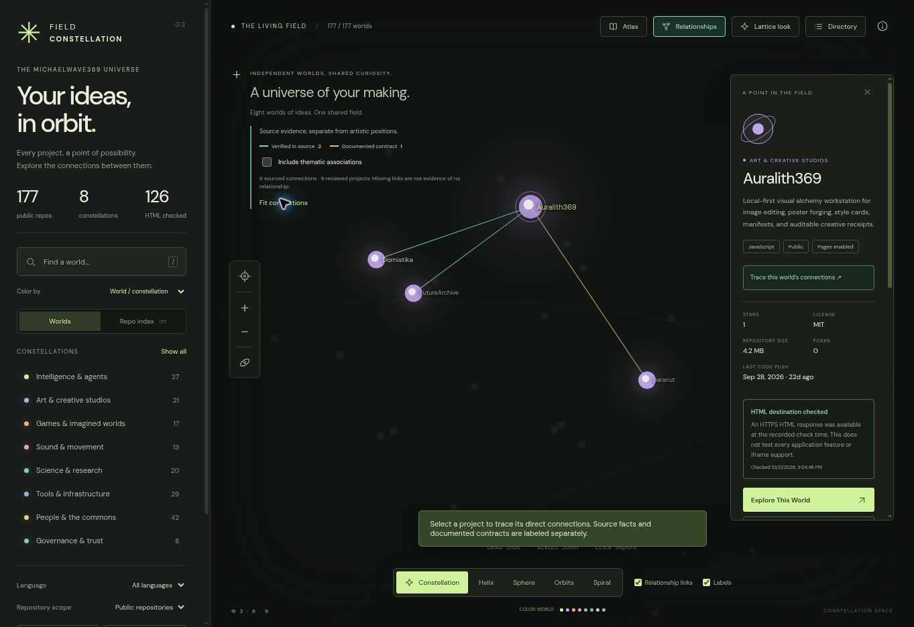

# The Phitarium · Field Constellation 18

An interactive observatory for [MichaelWave369’s public GitHub ecosystem](https://github.com/MichaelWave369?tab=repositories), continuing Edition 02 and the user-supplied Grok Field Lattice.

[Open the production map](https://michaelwave369.github.io/FieldConstellation/) · [Build and deployment status](https://github.com/MichaelWave369/FieldConstellation/actions) · [Read the Field Atlas](https://michaelwave369.github.io/FieldAtlas/)



## Edition 24 · Solar System Discovery (November 4, 2026)

**Solar System Discovery** turns the focused Solar Navigator into a guided public-project exhibit, using the current validated public inventory only. Focus a category sun, then select **Discover planets & guided route**. The dialog shows its top three repositories by **public GitHub stars**, its three **newest repositories by creation date**, and a five-stop-or-fewer route mixing public stars, creation dates, and last code push dates. These metrics are **not** proxies for project quality, deployment readiness, source dependencies, or technical completion.

- Clicking a listed planet or **Inspect planet** opens the normal Phitarium project inspector, keeping the existing repository links, Passport, and Quest behavior. The visitor decides when to inspect and thus save a discovery.
- **Previous / Next** browse the route in the dialog without collecting stars or changing Passport. Reopening the same unchanged route resumes the current stop; changing systems or visible repository filters generates a new route.
- The button only becomes available when Solar Systems mode has one category selected with at least one matching public repository. Existing filters, category focus, responsive navigation, original five layouts, and the Canvas2D fallback remain intact.
- All content is escaped and derived from *public* data already displayed. No new external API, authenticated requests, scheduled GitHub builds, Netlify usage, paid hosting, or tracking is introduced.
- Automated tests cover filtering, public-only selection, deterministic order at 650 projects, dialog controls on desktop/mobile/Canvas, and the existing inspector. On-device Quest browser acceptance remains unverified.

See [Edition 24 discovery contract](docs/EDITION_24_SOLAR_DISCOVERY.md).

## Edition 23 · Solar Navigator / Focus Mode (November 4, 2026)

Solar Systems now has a **Solar Navigator**, letting visitors select any of the eight existing category suns from a keyboard-accessible, touch-friendly control. Selecting a category focuses the camera on that system and filters the visible public planets; **All systems** restores the global sky. The ordinary sidebar category buttons participate in the same behavior while Solar Systems mode is active.

Category suns are also pointer-clickable inside the existing Three.js or Canvas fallback map, with a tooltip explaining the public planet count. The selector remains the required accessible route because a 3D canvas is not inherently keyboard navigable. Counts follow the current public inventory and respect existing search and filter choices; neither category focus nor orbit decoration asserts a source dependency or project health. The selected mode remains opt-in, with motion off by default.

Responsive controls and browser acceptance test focus/reset on desktop, mobile and Canvas. Existing Phitarium modes, Six Houses, saved Passport/Quest state and published domain setups are unchanged. See [Edition 23 Solar Navigator notes](docs/EDITION_23_SOLAR_NAVIGATOR.md).

## Edition 22 · Solar Systems view (November 4, 2026)

**Solar Systems** is a sixth Phitarium viewing mode, inspired by an astronomical taxonomy of 220+ code repositories. It reuses the existing public-only GitHub inventory, 3D Three.js render path, and accessible Canvas2D fallback. The eight editorial project constellations become decorative category **suns**, with their public repositories orbiting as **planets**. Three guide rings per sun make the model easy to read. This does not modify the underlying verified architectural relationship ledger.

- **Category sun:** a thematic project grouping, not a verifiable code dependency.
- **Planet position:** relative distance is determined by *time since last code push*, not health or abandonment. Stable project identity determines angular position.
- **Planet size:** already derives from GitHub-reported repository size (KB), not lines of code or business impact.
- **Glow:** recent push activity and public stars/forks increase brightness; archived repos are dimmed and explicitly labeled in the inspector.
- **Movement:** an opt-in **Move planets** checkbox animates the metaphor at restrained speed. Default off; disabled when the visitor requests reduced motion. Animation pauses with the hidden tab.
- **Meaning:** public-repository metadata is a visual metaphor, **not** proof of runtime integration, code quality, deployment, CI health, or working apps.

The original five layouts, Quest/Passport browser-local saves, project deep links, Six Houses, public-only refresh logic, and no-Netlify build workflow remain unchanged. Tests cover 600+ repo layouts, orbital-distance preservation, keyboard-operable controls, motion opt-in, mobile, and Canvas fallback. See [Solar Systems design and evidence contract](docs/EDITION_22_SOLAR_SYSTEMS.md).

## Edition 21 · Field Gateway (November 4, 2026)

A new **Field Constellation gateway** is staged at `/gateway/index.html`, designed to become the future `enterthefield.org` entrance only after explicit release approval. The standalone, static HTML/CSS page has three entry routes: the **Phitarium**, its **full project Directory**, and **Other Fields / the Six Houses**. The PhiOS-centered architecture points to real public repository stars for PhiOS, Infinite Porch, and Infinite Commons, with separate PhiOS Mobile and XR source links. These thematic routes do **not** claim native installers, production integration or live peer networks.

The Phitarium now spotlights the PhiOS source record by default and supports an explicitly requested `?directory=1` deep link without opening the Directory on ordinary visits. Original games, Passport, dated reachability records, existing deep links, and Six Houses are preserved. The gateway references `phi-field.com` as the dedicated PhiOS entry and does not modify that website.

The [Edition 21 migration audit](docs/EDITION_21_FIELD_GATEWAY.md) documents the current Parallax-era `enterthefield.org` navigation, the legacy 47-project registry, preservation of deep URL families and historical material, and **unverified manual Quest headset acceptance**. No Netlify deployment, domain switch, redirects or release were performed for this PR.

## Edition 20 · Browser-local auto-updates and sortable discoveries (November 4, 2026)

The constellation can now **check for updated public GitHub inventory automatically once per day per browser**, subject to its bundled snapshot age and the most recent attempt. It uses the existing fully paginated, public-only anonymous GitHub REST check. Auto-check can be switched off in the sidebar. It is deliberately **not** a scheduled GitHub commit or a Netlify build; visitors without public GitHub API access retain the last valid complete snapshot. Manual Refresh always remains available.

The **Sort** button in the repository index cycles A–Z, recently pushed, newest created, and most stars. The full Directory sort selector follows the same choice; the 3D spatial layout and saved public repository IDs are not re-ordered. See [Edition 20 contract](docs/EDITION_20_AUTO_DISCOVERY.md).

## Edition 19 · 225 public stars (November 4, 2026)

The Phitarium now includes **225 public repositories**, up from the November 1 snapshot of 211. A connected GitHub owner search fully paginated 260 accessible repositories (100 + 100 + 60 + empty fourth page): **225 public and 35 private**. All 211 prior public identities are retained. Fourteen additions have source-checked public metadata: CompAware, PhiRSI, phi-field, ElsewhereEngine, ShedofShadows, InfiniteTinkerer, RetroVerse, Blackout, PaperGhost, Altermath, G-FunkProp, PhiMadaPrime, PhiBridge369, RacetoOblivion.

**Freshness boundary:** November 4 is the date the full public identity set was reconciled, not a claim that the prior 211 records were newly audited field-by-field. Older Atlas, deployment checks, and architectural relationship evidence keep their own original dates. Category placement is thematic and does not prove working integrations, installs, or live deployments.

The visitor Refresh control already provides a browser-local fully paginated public GitHub REST refresh without Netlify. It preserves the existing view on API failure and never exposes private repository data. See [Edition 19 audit](docs/EDITION_19_PUBLIC_INVENTORY.md).

## Edition 18 · Immersive Dome & the living exhibits (November 1, 2026)

**Enter Dome** opens a full-viewport planetarium experience around the original interactive repository constellation. Hide the technical UI, fly between twelve curated *real public* project stars, read their current public-repository descriptions and inspect the wider field. The sky adds soft CSS nebulae and occasional decorative meteors, with reduced-motion support. The exhibit route works with both WebGL and Canvas fallback and needs no login or external media.

**Previous / Next / arrow keys** change the spotlight and camera without silently adding Quest RPG XP, changing the current URL or writing visit history. **Explore this star** is the explicit action that opens the real repository inspector and records a normal local discovery. **Read project README** opens its real GitHub docs. **Quest RPG**, **Exit Dome**, and **Escape** return to the existing features; previous selection, saved Passport, gameplay, and user camera preferences are preserved.

The old **0 HTML checked** label also gets a truthfulness fix. The supplied destination receipt was last verified on **October 21**, beyond its seven-day limit, so the sidebar now displays **— / checks expired** instead of implying zero functional websites. New fresh receipts must match declared public HTTPS destinations, and even then certify **an HTML response only**, not complete application health.

See [Edition 18 immersive design, accessibility and evidence contract](docs/EDITION_18_IMMERSIVE.md). No new package, backend, personal tracking or runtime integration claims were introduced.

## Edition 17 · The Phitarium: Living Repository Planetarium (November 1, 2026)

The interactive observatory is now **THE PHITARIUM**, a cinematic planetarium experience around the existing, real public-repository star map. The scene has a celestial meridian/altitude grid, deep-sky colors, projected dome framework, observatory instrument UI, and updated Φ branding. The existing five layouts, public catalog, Atlas/relationships evidence, Field Passport, Nine Gates, Outer Field, and independent save states are preserved.

An optional **Dome Show** offers a short six-star fly-through: FieldConstellation, FieldAtlas, PhiOS, PhiServe, BTM and GenEWrist. These are public, curated examples. The tour uses their current public-repository descriptions, with next/end and **Explore this star** controls. **Watching is read-only**: it does not silently mark a project visited, collect XP, import data, change URL history or save bookmarks. Explicitly exploring a star uses the familiar inspector and discovery mechanics. User camera input ends the show, the presentation pauses when the tab is hidden, and reduced-motion visitors advance manually. WebGL and Canvas fallback render the same dome-grid geometry.

**Honesty:** A planetarium star represents a public repository, not a working deployment or verified integration. The curated show does not upgrade any architecture evidence, destination claims, or permissions. No new account, tracking, network API, external image, package or dependency is required.

See [Edition 17 design, privacy and accessibility contract](docs/EDITION_17_PHITARIUM.md).

## Edition 16 · The Outer Field: Infinite Spiral (November 1, 2026)

The **postgame RPG** is here. After clearing all **9/9 Nine Gates**, visitors can enter **The Outer Field**, a second nine-encounter story made of three real-project artifact hunts, two conceptual combination puzzles, one hidden-world star hunt, and a three-stage **Fracture Warden** boss. Four of these challenges require actually exploring their repository stars to claim items. Wrong answers reveal hints and never cost XP.

Winning the adventure awards up to **400 additional game XP**, a fictional four-piece artifact inventory, and the **Infinite Spiral portal**, which sends players back to the live Constellation map in its golden-angle spiral layout. The original Nine Gates victory screen now opens the postgame, and the Quest RPG journal also offers an entrance. All UI works without a login, external backend, new dependency or VR headset; existing map rendering and Passport behavior remain unchanged.

**Truth boundary:** Missions are educational fiction grounded in public README descriptions, with links to sources. Combining two repo names **never asserts a verified running integration**. The Fracture Warden finale explicitly distinguishes public repository presence from independently verified website reachability and integration evidence. XP, loot, boss shields and the portal are only browser-local game state, not execution authority or proof of deployment. See [Edition 16 contract, controls and privacy](docs/EDITION_16_OUTER_FIELD.md).

## Edition 15 · The Nine Gates playable quest campaign (November 1, 2026)

The existing **Quest RPG** now includes **Play The Nine Gates**, a three-chapter, nine-mission educational adventure. A visitor reads a fictional situation, chooses between three **real, public repositories**, and learns which tool fits the task and what it **cannot** yet do. Correct answers earn **30 mission XP per gate (270 total)**, with chapter unlocks, no-penalty hints for wrong guesses, and links to the repository's README and its existing star in the 3D Field.

This is a **real browser-playable quest campaign**, not merely a list of destinations. It is local-first and requires no login, WebXR headset or backend. Its saved progress consists solely of validated, sequential mission IDs in browser storage and can be independently reset without touching Passport favorites, public repository discoveries or postcards.

**Truth boundary:** Mission choice descriptions were reviewed from the projects' public README files, but do not certify current runtime capability, deployments or CI. The Nine Gates story is fiction, rewards are game XP, and no new technical relationship edges or execution permissions are created. See [Edition 15 campaign and privacy contract](docs/EDITION_15_NINE_GATES.md).

## Edition 14 · 211 Public Stars (November 1, 2026)

The **current checked-in snapshot reconciles 211 unique public repositories** against a complete three-populated-page GitHub repository search (with a fourth empty page). The prior October 29 Edition 12 snapshot held 199 public repositories. **Twelve newly identified public projects** are now collectible stars: PhiSafe, LWG, PhiServe, PieceByPiece, Opti-Eyes, ReelTheater, PhiVine, CycleWeave, PhiDecisionField, PhiOS-Mobile, PhiOperator and PhiXRCommons.

New projects have explicit reviewed **thematic groups** across the existing 3D layouts and the Quest RPG's eight skill-tree branches. **Fresh Stars · New Discoveries** provides a twelve-stop collector trail. These groupings and tours are **editorial associations, not executable integrations**. The Field Passport and Quest Journal remain separate browser-local collections keyed by public numeric GitHub IDs.

**Freshness scope:** Repository identities were reconciled on November 1 from a paginated GitHub repository search; the twelve additions' public metadata was read directly from their repository API records. The previously recorded 199 records retain their independently dated October 29 metadata, rather than falsely implying every field was freshly fetched. The separately dated Atlas chapter and published-HTML manifests and destination checks are **not** refreshed, and should not be advertised as live health or complete coverage of 211 repos. No private repo records are bundled or exposed. Older historical counts below remain documentary history.

## Edition 13 · The Infinite Tinkerer RPG (November 1, 2026)

**Quest RPG** adds an optional, browser-local game layer to the existing public constellation. The **Quest RPG** header button opens an eight-branch skill tree with discoverable public repositories, 10 playful XP per unique explored project, 3/6/9 milestone ranks, and local achievements. Branch buttons jump back to their next unvisited public star in the real map.

The **Quest discoveries** color lens distinguishes explored from unexplored stars. An existing Passport's favorites and recent visits seed the new journal once; a separate **Reset discoveries** button clears only the RPG journal, not the Passport. No account, tracking, game engine, backend or external write permissions are required. The RPG uses **public numeric GitHub repository IDs only**, pruning unavailable IDs when the public listing changes.

**Important:** RPG ranks, XP and badges are not PR merges, successful builds or deployment checks. Its eight branch paths are editorial categories, not software dependencies. The `Evidence Trail` achievement counts exploration of both endpoints in the existing, source-reviewed relationship ledger, not proof of runtime integration.

See [Edition 13 Quest RPG contract](docs/EDITION_13_RPG.md).

## Edition 12 · New Worlds and refreshed public coverage (October 29, 2026)

The bundled **public-only GitHub listing now includes 199 unique owner repositories**, collected by a complete anonymous three-page REST read on October 29, rather than the previous 177-repo observation. All 22 newly discovered public repositories receive stars, including BTM, SparkTheSubstrate, EchoesOfTheNine, TweedleVerse, LENZ, FieldStoryForge, BackyardProductionCompany, GenEWrist, PhiOS-XR, PhiARK, PhiPress and other new research or creative experiments. The listing is a dated snapshot, not a private-account inventory. Older Edition 01–11 counts below describe their historical observations.

Two **new guided trails** add an editorial introduction to the game worlds and a Studio Circuit for storytelling and creative infrastructure. They remain repository tours rather than claims of interoperability, active installations or deployed demos. New games and studios have reviewed thematic groups in all five existing star layouts; the relationship ledger remains untouched.

The **Atlas published-site lens** was separately refreshed from its live, public deployment manifest generated **2026-10-29T19:41:28.240Z**, showing **148 independently verified HTML destinations** from **199 publicly listed repositories**. Each record was matched against the public numeric GitHub repository ID *and* case-insensitive repository name before being admitted. The reviewed chapter crosswalk now contains **131** IDs, retaining its earlier 124 and adding seven source-reviewed public projects from the Atlas's New Horizons update. These are different evidence classes.

**Known limits:** EchoesOfTheNine has a public repository star but its `/EchoesOfTheNine/` destination returned 404 in the audit. It is not falsely added to the published-site list. An HTML response is not proof that a game starts, that WebXR works, or that a remote site permits framing. The old destination-check snapshot retains its original observation date and is not silently re-labeled as fresh. If a seven-day Constellation site check has expired but the separately dated Atlas manifest contains a verified HTML URL, the inspector now offers **Open Atlas-listed website** as a direct full-tab fallback. It is explicitly labeled and does not renew the independent deployment status. The Atlas itself can offer direct-first launching and safe, explicitly optional iframe previews.

The separate Field Atlas↔Constellation deep links still use public `github:<numeric-id>` identities; unknown and private identities are never fetched or promoted. No cross-origin passport sharing, authenticated API, runtime permission changes, new dependency graph edges or automatic publishing are introduced.


Edition 11 adds real-browser visitor acceptance gates to Edition 10's shareable Postcards, local Passport, Coverage Ledger and Atlas bridges. Production serves the last merged `main` deployment; pull requests build and validate without replacing it.

## Explore the Living Architecture

The five original layouts remain: thematic constellation, Fibonacci sphere, chronological helix, language orbits, and golden-angle spiral. World/language/activity colors, Field green, Lattice gold, search, the index, directory, Pages/fork filters, random discovery and both rendering paths are preserved.

**Relationships** is an optional layer on those same layouts:

- **Verified in source · mint:** inspected bridge code, navigation links, or shared library declarations. This does not prove a live integration or an inter-repository import.
- **Documented contract · gold:** an explicit public integration claim or candidate contract, with its limits retained.
- **Thematic association · lavender:** optional editorial neighbors in the same curated world. Off by default; never represented as code dependencies.

Select a project to emphasize its direct neighbors and dim unrelated nodes. **Fit connections** frames the relevant group. The inspector lists incoming/outgoing/shared relationships, commit-pinned evidence, review dates and scope. Missing links mean **not recorded**, rather than proof that no relationship exists.

The first ledger contains **eight sourced connections across nine public projects**: five source facts and three documented contracts. This is a bounded review, not an exhaustive dependency audit of 177 repositories. The two React manifests in the shared-library relationship use different major versions; compatibility is not implied.

Drag to orbit, scroll/pinch to zoom, and right-drag or Shift-drag to pan. `/` focuses search; `Esc` clears selection/search; arrow keys rotate a focused map and visit projects elsewhere. Use the directory for a full keyboard-accessible list. Reduced-motion preferences are respected.

## Guided Trails · Edition 04

Open **Guided trails** in the map header to follow a five-stop introduction through the public Field. Three routes introduce the Atlas and observatory, making tools and studios, and research and trust projects. Each stop focuses the existing 3D map and inspector; use **Previous**, **Next world**, or **Exit** to navigate. Selecting an unrelated project, clearing the selection, or resetting filters exits the trail without interfering with ordinary search and exploration.

**These routes are editorial introductions, not evidence-backed dependency graphs.** They do not add edges to the Relationships ledger or imply operational integrations. Stops resolve against the validated public inventory; missing or private projects are skipped, and routes with fewer than three public stops do not appear. The application performs no private API lookups and needs no new dependencies. See `src/trails.js` and `tests/trails.test.mjs`.

## Shareable Journeys · Edition 05

A guided trail now has a **Copy stop link** action. Its URL records the reviewed trail ID, a 1-based stop index and the same stable public GitHub repository ID used by the regular inspector. For example, `?trail=first-light&stop=1&repo=github:<id>` (replace `<id>` with the actual numeric public repository ID). A visitor opening that link starts at the intended point of the tour, with the map and inspector focused as usual. Next/Previous stops add browser history entries; Back/Forward restores the stop. Exiting the journey strips tour parameters while retaining the selected ordinary repository link.

Shared journeys are validated against the **current complete public snapshot**. Unknown trails, duplicate/inconsistent parameters, missing or private repositories and out-of-range stops are not restored. Routes are still editorial introductions and are never promoted into technical dependency evidence. No private lookups, runtime dependency, cookie tracking or backend were added. A select-and-copy fallback is available if the browser denies clipboard permission.

## Field Passport · Edition 06

Open **Passport** in the map header to see saved and recently explored public projects. Use **Save to Passport** in any project inspector to toggle a favorite. Selecting a saved or recent project uses the existing map and inspector.

Passport data lives **only in your browser's localStorage** under a dedicated versioned key. It stores `github:<numeric-id>` values, not project descriptions, links, private inventory, or user details. Recent history contains at most 20 unique public IDs. Favorites are bounded to 200 entries. Refreshing the public inventory removes saved IDs that are no longer part of the validated public dataset; nothing attempts to fetch private repositories.

**Export favorites JSON** creates a small local file containing only favorite IDs. **Import favorites JSON** merges known public favorites with current saves, skipping unknown or now-private IDs. It never imports/export recent history, never sends data to a server, and requires no account. Browser local-storage restrictions may cause bookmarks not to persist after refresh; the UI warns users when a write fails. Clear commands require confirmation.

This feature does not sync between devices or with Field Atlas, and it does not imply a dependency between saved projects. Existing repository links, tours and evidence remain separate.

## Atlas Lens · Edition 07

**Atlas chapters** in the sidebar filters the existing 3D layouts, searchable index and repository directory to projects represented by the **reviewed, public-only Atlas chapter map** (`src/atlas.json`). Switch it off to show all public worlds again. A dated label explains exactly which chapter map the filter uses. The selected project inspector marks reviewed Atlas chapters and offers **Read in Field Atlas**, preserving the book's existing `?chapter=<RepoName>` navigation.

The checked-in Atlas map contains **124 reviewed public chapter identities as of October 21, 2026**. The live Atlas was observed later with more chapters. **This is not a live completeness claim:** projects added or removed since the review do not automatically change the map. The lens is unavailable if its manifest is invalid or no longer resolves to current public repos. It never fetches unknown or private repository identifiers.

The Atlas remains an independent book; this change only modifies FieldConstellation. A [separate Atlas-side two-way link proposal](docs/ATLAS_TWO_WAY_BRIDGE_PROPOSAL.md) specifies how to support stable `github:<id>` return links without changing the Atlas until separately authorized.

## Atlas Pulse · Edition 08

**Two provenance levels, clearly separated:**

- **Reviewed chapters** is the unchanged `atlas.json` crosswalk, reviewed October 21, 2026, with **124** public chapter identities in the older Constellation inventory. These link using Atlas's original `?chapter=RepoName` deep links.
- **Atlas published sites** uses a new immutable, dated `atlas-published.json` copy of Field Atlas's **public Pages verification manifest** from **October 22, 2026 at 02:54 UTC**. The Atlas snapshot verified **126** public HTML destinations from an owner listing of **179** public repos. The Constellation repository snapshot currently contains **177** public repos; **125 of those 126** published-site IDs match. One verified Atlas project, `PhiOS-XR`, is absent from Constellation's earlier snapshot and is not invented as a star.

This does **not** mean there are only 126 Atlas chapters. The live book was separately observed showing **141 available chapters**, including seed, published and publication entries. A public-site verification is not a curator review, a guarantee the application functions, or a guarantee that a particular visitor's customized Atlas shelf contains the chapter. Dates and provenance appear directly in the UI. The two filters are mutually exclusive but work with normal search, categories, and directory filters. Both filters fail closed against invalid source data or a non-public/missing project.

A project in the published-site crosswalk can open an Atlas `?project=github:<numeric-id>` deep link, which Field Atlas now validates against its own current verified public manifest. No cross-origin browser fetch, private repository lookup, account, visitor passport sharing or dependency claim is involved. The data changes only through a reviewed commit, **not live on every page load**.

## Coverage Ledger · Edition 09

The **View coverage ledger** control below the Atlas filters opens a transparent, accessible comparison of three **different** public observations: the displayed Constellation repository inventory, the curator-reviewed Atlas chapter map, and Atlas's public Pages-verified published-site snapshot.

The dialog exposes exact public matching counts, each underlying observation date, and a short list of **published-site records that cannot be matched to the currently displayed Constellation repository snapshot**. An unmatched project does **not** mean a private repository, broken site or failed integration. For example, the bundled older public repo inventory lists 177 records while the separately dated published Atlas manifest lists 126 verified HTML sites; 125 match by public numeric repository ID plus name, and PhiOS-XR appears only in the newer published snapshot.

**Refresh public repository listing** reuses Constellation's existing anonymous, fully paginated GitHub public-repository refresh, with all-or-nothing validation and preservation of previous data on failure. It does not change the Atlas source manifests. If a newly published public repository is now in the listing, the ledger reconciles it after refresh.

**Export coverage JSON** creates a reproducible, dated, read-only receipt describing these independently sourced counts and mismatches, with explicit caveats. It contains only public repository IDs and names, never local Passport favorites, history, cookies or visitor identity. If an Atlas source is malformed or unavailable, the ledger says **Unavailable**, not zero coverage. The existing five layouts, Passport, evidence-backed relationships and Atlas navigation remain unchanged.

## Field Postcards · Edition 10

A **Field Postcard** is a visitor-chosen collection of **1–8 currently public GitHub repository IDs** that opens in a preview dialog on another visitor's Constellation. To create one, first save worlds in **Field Passport**, then select **Make Field Postcard**. Choose at most eight saved projects and click **Copy postcard link**. If browser clipboard access is unavailable, an editable-selection fallback shows the exact link for manual copying.

The link uses a bounded, validated `?postcard=github:<id>,github:<id>` query parameter. Creating a share link does not include the visitor's Passport backup, previously viewed projects, local names, timestamps, history, cookies, or credentials. It also strips unrelated `repo` and curated trail parameters from the shared URL so the recipient sees a postcard, not an accidental tour.

**Opening someone else's postcard never imports it.** Visitors can preview currently public worlds, open one in the 3D map, or explicitly click **Save these worlds to my Passport**. An invalid, duplicated, oversized, or fully unavailable postcard is rejected; unknown or now-unavailable IDs in an otherwise valid link are omitted without revealing private metadata. The Passport only changes after explicit selection, and its existing local-first storage limits are respected. No backend, authenticated GitHub lookup, live destination certification, cross-origin browser storage or analytics service is involved.

## Browser-Proven Journeys · Edition 11

Every pull request and `main` push now has a **blocking Chromium acceptance gate** after the existing public data, JavaScript syntax, unit-test, production build and Pages audit checks. Deployment depends on the successful completion of this real-browser verification.

The gate exercises the actual built static site served locally under its canonical `/FieldConstellation/` GitHub Pages subpath. It tests:
- Desktop project deep links, inspector and opt-in Passport saving across reloads.
- Choosing two saved worlds, creating a postcard and the selectable copy fallback when clipboard access is unavailable.
- A separate anonymous browser opening the postcard without automatically importing favorites, explicitly saving the public collection, and navigating to the selected project's star.
- A touch-enabled mobile viewport with accessible postcard preview and Escape dismissal.
- A forced **no-WebGL2** environment with a usable public repository directory.
- Checks for uncaught JavaScript errors, public inventory rendering, correct URL cleanup, and no inadvertent history export.

The workflow uploads a small screenshot packet to the workflow artifacts for visual review. The browser tool is **CI-only**, installed temporarily in GitHub Actions after `npm ci`; it is not a new browser/runtime app dependency. To run locally:

```bash
npm ci
npm run build
npm install --no-save --package-lock=false playwright@1.56.1
npx playwright install --with-deps chromium
npm run acceptance:browser
```

The acceptance gate verifies concrete scripted journeys. It does **not** claim exhaustive accessibility, production network availability, content correctness or general human sign-off.

## Accurate counts and live destinations

The bundled snapshot contains **177 public repositories**, fetched on 21 October 2026. The current public listing was fully paginated and compared with Edition 02: no added or removed repositories; ten records had metadata changes.

The earlier owner-only hosted snapshot had **212 records: 176 public and 36 private**. The later public export included FieldConstellation itself, bringing its public total to 177. These are different scopes and capture times. This public application contains no private repository records, names, IDs or URLs taken from that private inventory. See the [audit](docs/EDITION_03_AUDIT.md) for the exact reconciliation and its limits.

**Pages enabled is not the same as a working application.** The bundled observation checks 127 eligible HTTPS destinations: **126 returned an HTML document and one returned 404**. The header counts recent HTML observations, separately from the 126 Pages flags. Each inspector shows its own check date and status.

**Explore This World** appears only for a matching destination checked within seven days. The check requires a 2xx `text/html` response and an HTML document marker within the first 8 KiB. It does not test every application feature, iframe support, authenticity or continuous uptime. Restricted/time-limited requests are inconclusive. Stale, unavailable, unchecked and undeclared destinations have explicit explanations; declared unverified URLs remain separately labeled.

## The Atlas bridge

The public [Field Atlas entrance](https://michaelwave369.github.io/FieldAtlas/) was read from public repository metadata and checked over HTTPS. Constellation links to that entrance globally and to **124 reviewed public chapters** where the shared Atlas manifest supports them. Other projects open the entrance without promising a chapter. Browser-customized Atlas shelves may differ.

Shareable Constellation links use the stable GitHub repository ID:

```text
?repo=github:1428952721
```

Only records in the currently loaded public inventory resolve. An unknown ID never triggers a private lookup or an external redirect. The Atlas continues to use its existing `?chapter=RepoName` interface. No FieldAtlas files are changed; the [bridge proposal](docs/ATLAS_BRIDGE.md) describes future ID alignment.

## Run, test and build

Requires Node.js 22 or later. No account, paid API, server secret or new runtime dependency is needed.

```sh
npm ci
npm run check
npm test
npm run build
npm run build:verify
npm run preview
```

Open `http://localhost:4173/FieldConstellation/`. Assets and modules use relative paths, including fonts and rendering code. The preview server also accepts `/`.

## Refresh public data

```sh
npm run refresh
npm run destinations:check
npm run atlas:refresh
npm test
npm run build
npm run build:verify
```

Review the JSON diff and submit a PR. These commands update separate checked-in observations:

- `refresh`: validates every page of the anonymous GitHub public inventory and atomically replaces `src/repos.json`. An incomplete, duplicated, invalid or non-public response leaves the saved file unchanged.
- `destinations:check`: bounded HTTPS checks of public homepage/Pages candidates, with six workers and no app actions. Review failures and redirects. Re-run at least weekly if fresh availability buttons are desired.
- `atlas:refresh`: maps the Atlas’s public shared manifest to IDs already in Constellation’s public inventory. Empty or invalid results preserve the chapter map.

Browser refresh updates only that browser’s public cache. It preserves the displayed dataset on failure and handles GitHub rate limits with a useful message. It does **not** silently reset destination/evidence check dates. The snapshot remains usable without refreshing.

To add a relationship, review public source, add a typed record and commit-pinned evidence to `src/relationships.json`, and run the tests. Both endpoint IDs and evidence repositories must belong to the public inventory. Do not auto-promote thematic similarity or a README claim into a proven dependency.

## Deployment and architecture

The existing GitHub Actions workflow validates, tests, builds, audits `/FieldConstellation/` assets and uploads the Pages artifact. Only `main` deploys. Pull requests cannot deploy to production. Pages uses GitHub Actions as its configured source.

See [architecture](docs/ARCHITECTURE.md), [milestone/requirements](docs/EDITION_03_MILESTONE.md), [validation](VALIDATION.md), [changelog](CHANGELOG.md) and [Grok provenance](GROK-INTEGRATION.md).

App code remains MIT licensed. Three.js is pinned to `0.180.0` and MIT licensed; DM Sans retains the SIL Open Font License. The build preserves both vendor notices. Hardware WebGL verification and a complete ecosystem relationship review remain open work.

**Ledger Above Ego.**
