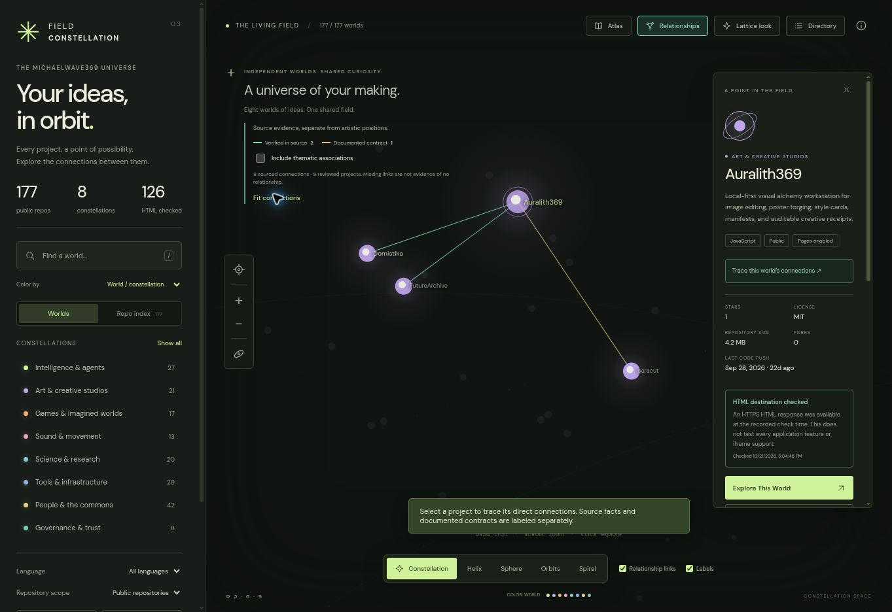

# Field Constellation 05 · Shareable Journeys

An interactive observatory for [MichaelWave369’s public GitHub ecosystem](https://github.com/MichaelWave369?tab=repositories), continuing Edition 02 and the user-supplied Grok Field Lattice.

[Open the production map](https://michaelwave369.github.io/FieldConstellation/) · [Build and deployment status](https://github.com/MichaelWave369/FieldConstellation/actions) · [Read the Field Atlas](https://michaelwave369.github.io/FieldAtlas/)



Edition 05 adds safe, shareable links and browser history to Edition 04’s curated discovery paths. Production serves the last merged `main` deployment; pull requests build and validate without replacing it.

## Explore the Living Architecture

The five original layouts remain: thematic constellation, Fibonacci sphere, chronological helix, language orbits, and golden-angle spiral. World/language/activity colors, Field green, Lattice gold, search, the index, directory, Pages/fork filters, random discovery and both rendering paths are preserved.

**Relationships** is an optional layer on those same layouts:

- **Verified in source · mint:** inspected bridge code, navigation links, or shared library declarations. This does not prove a live integration or an inter-repository import.
- **Documented contract · gold:** an explicit public integration claim or candidate contract, with its limits retained.
- **Thematic association · lavender:** optional editorial neighbors in the same curated world. Off by default; never represented as code dependencies.

Select a project to emphasize its direct neighbors and dim unrelated nodes. **Fit connections** frames the relevant group. The inspector lists incoming/outgoing/shared relationships, commit-pinned evidence, review dates and scope. Missing links mean **not recorded**, rather than proof that no relationship exists.

The first ledger contains **eight sourced connections across nine public projects**: five source facts and three documented contracts. This is a bounded review, not an exhaustive dependency audit of 177 repositories. The two React manifests in the shared-library relationship use different major versions; compatibility is not implied.

Drag to orbit, scroll/pinch to zoom, and right-drag or Shift-drag to pan. `/` focuses search; `Esc` clears selection/search; arrow keys rotate a focused map and visit projects elsewhere. Use the directory for a full keyboard-accessible list. Reduced-motion preferences are respected.

## Guided Trails · Edition 04

Open **Guided trails** in the map header to follow a five-stop introduction through the public Field. Three routes introduce the Atlas and observatory, making tools and studios, and research and trust projects. Each stop focuses the existing 3D map and inspector; use **Previous**, **Next world**, or **Exit** to navigate. Selecting an unrelated project, clearing the selection, or resetting filters exits the trail without interfering with ordinary search and exploration.

**These routes are editorial introductions, not evidence-backed dependency graphs.** They do not add edges to the Relationships ledger or imply operational integrations. Stops resolve against the validated public inventory; missing or private projects are skipped, and routes with fewer than three public stops do not appear. The application performs no private API lookups and needs no new dependencies. See `src/trails.js` and `tests/trails.test.mjs`.

## Shareable Journeys · Edition 05

A guided trail now has a **Copy stop link** action. Its URL records the reviewed trail ID, a 1-based stop index and the same stable public GitHub repository ID used by the regular inspector. For example, `?trail=first-light&stop=1&repo=github:<id>` (replace `<id>` with the actual numeric public repository ID). A visitor opening that link starts at the intended point of the tour, with the map and inspector focused as usual. Next/Previous stops add browser history entries; Back/Forward restores the stop. Exiting the journey strips tour parameters while retaining the selected ordinary repository link.

Shared journeys are validated against the **current complete public snapshot**. Unknown trails, duplicate/inconsistent parameters, missing or private repositories and out-of-range stops are not restored. Routes are still editorial introductions and are never promoted into technical dependency evidence. No private lookups, runtime dependency, cookie tracking or backend were added. A select-and-copy fallback is available if the browser denies clipboard permission.

## Accurate counts and live destinations

The bundled snapshot contains **177 public repositories**, fetched on 21 October 2026. The current public listing was fully paginated and compared with Edition 02: no added or removed repositories; ten records had metadata changes.

The earlier owner-only hosted snapshot had **212 records: 176 public and 36 private**. The later public export included FieldConstellation itself, bringing its public total to 177. These are different scopes and capture times. This public application contains no private repository records, names, IDs or URLs taken from that private inventory. See the [audit](docs/EDITION_03_AUDIT.md) for the exact reconciliation and its limits.

**Pages enabled is not the same as a working application.** The bundled observation checks 127 eligible HTTPS destinations: **126 returned an HTML document and one returned 404**. The header counts recent HTML observations, separately from the 126 Pages flags. Each inspector shows its own check date and status.

**Explore This World** appears only for a matching destination checked within seven days. The check requires a 2xx `text/html` response and an HTML document marker within the first 8 KiB. It does not test every application feature, iframe support, authenticity or continuous uptime. Restricted/time-limited requests are inconclusive. Stale, unavailable, unchecked and undeclared destinations have explicit explanations; declared unverified URLs remain separately labeled.

## The Atlas bridge

The public [Field Atlas entrance](https://michaelwave369.github.io/FieldAtlas/) was read from public repository metadata and checked over HTTPS. Constellation links to that entrance globally and to **124 reviewed public chapters** where the shared Atlas manifest supports them. Other projects open the entrance without promising a chapter. Browser-customized Atlas shelves may differ.

Shareable Constellation links use the stable GitHub repository ID:

```text
?repo=github:1428952721
```

Only records in the currently loaded public inventory resolve. An unknown ID never triggers a private lookup or an external redirect. The Atlas continues to use its existing `?chapter=RepoName` interface. No FieldAtlas files are changed; the [bridge proposal](docs/ATLAS_BRIDGE.md) describes future ID alignment.

## Run, test and build

Requires Node.js 22 or later. No account, paid API, server secret or new runtime dependency is needed.

```sh
npm ci
npm run check
npm test
npm run build
npm run build:verify
npm run preview
```

Open `http://localhost:4173/FieldConstellation/`. Assets and modules use relative paths, including fonts and rendering code. The preview server also accepts `/`.

## Refresh public data

```sh
npm run refresh
npm run destinations:check
npm run atlas:refresh
npm test
npm run build
npm run build:verify
```

Review the JSON diff and submit a PR. These commands update separate checked-in observations:

- `refresh`: validates every page of the anonymous GitHub public inventory and atomically replaces `src/repos.json`. An incomplete, duplicated, invalid or non-public response leaves the saved file unchanged.
- `destinations:check`: bounded HTTPS checks of public homepage/Pages candidates, with six workers and no app actions. Review failures and redirects. Re-run at least weekly if fresh availability buttons are desired.
- `atlas:refresh`: maps the Atlas’s public shared manifest to IDs already in Constellation’s public inventory. Empty or invalid results preserve the chapter map.

Browser refresh updates only that browser’s public cache. It preserves the displayed dataset on failure and handles GitHub rate limits with a useful message. It does **not** silently reset destination/evidence check dates. The snapshot remains usable without refreshing.

To add a relationship, review public source, add a typed record and commit-pinned evidence to `src/relationships.json`, and run the tests. Both endpoint IDs and evidence repositories must belong to the public inventory. Do not auto-promote thematic similarity or a README claim into a proven dependency.

## Deployment and architecture

The existing GitHub Actions workflow validates, tests, builds, audits `/FieldConstellation/` assets and uploads the Pages artifact. Only `main` deploys. Pull requests cannot deploy to production. Pages uses GitHub Actions as its configured source.

See [architecture](docs/ARCHITECTURE.md), [milestone/requirements](docs/EDITION_03_MILESTONE.md), [validation](VALIDATION.md), [changelog](CHANGELOG.md) and [Grok provenance](GROK-INTEGRATION.md).

App code remains MIT licensed. Three.js is pinned to `0.180.0` and MIT licensed; DM Sans retains the SIL Open Font License. The build preserves both vendor notices. Hardware WebGL verification and a complete ecosystem relationship review remain open work.

**Ledger Above Ego.**
